<p align="center">
  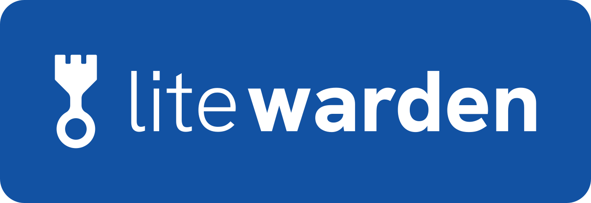
</p>

<h1 align="center">Fast, lightweight password manager extension for Vaultwarden</h1>

<p align="center">
  <a href="https://github.com/Concept211/Litewarden/actions/workflows/ci.yml"></a>
  <a href="LICENSE"></a>
  
  
  <a href="https://github.com/Concept211/Litewarden/issues"></a>
</p>

<p align="center">
  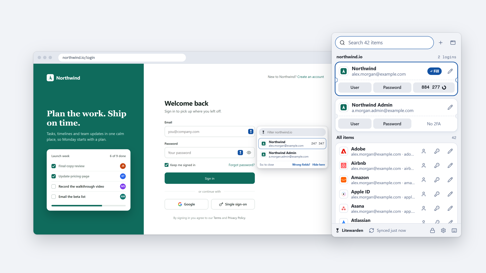
</p>

Litewarden is a free, open-source browser extension for people who run their own
[Vaultwarden](https://github.com/dani-garcia/vaultwarden) password server. It works in Chrome, Brave, Edge and other
Chromium browsers. It also works with Bitwarden servers.

It opens on the logins for the site you're on, fills with one key, and keeps its in-page menu away from the
page's own fields and buttons. Your vault stays end-to-end encrypted on your own server.

> [!NOTE]
> **Litewarden is in beta.** Expect some bugs. If something breaks, please
> [report it on GitHub](https://github.com/Concept211/Litewarden/issues/new/choose) with your browser, your
> Vaultwarden version and the site it happened on. Found a security problem? Please
> [report it privately](https://github.com/Concept211/Litewarden/security/advisories/new) instead.

Not affiliated with Bitwarden, Inc. or the Vaultwarden project.

## Why another Vaultwarden extension?

The official browser extension got slower and harder to use after its 2024 redesign, and some updates broke logins
on self-hosted servers. Litewarden is a smaller client that does the everyday things quickly:

- **Fast to open.** The popup is ready in about 100 ms with a 2,500-item vault.
- **One key to fill.** The logins for the current site are on top, and Enter fills the first one.
- **Out of the way.** The in-page menu opens only when you ask for it, and it never covers a form field, a
  show-password button or a submit button.

<p align="center">
  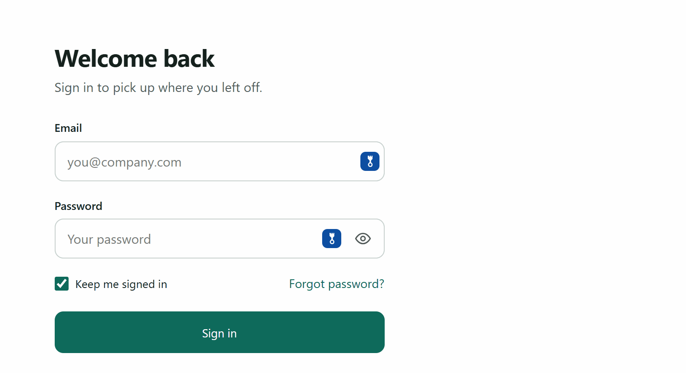
</p>

## Features

- **Popup**
  - Logins for the current site on top, one card each. Click or press Enter to fill.
  - Copy buttons for username, password and the live 2FA code on every card.
  - Search across names, usernames, websites, notes and folders, with the matches highlighted.
  - Your folders as a row of chips under the search box. One click shows just that folder, and the choice sticks.
  - A list of recently used items, or everything A to Z on a fresh install.
- **Autofill**
  - Reads `autocomplete` attributes first, then looks at labels and layout. Handles two-step logins (username page,
    then password page), forms in same-site iframes, shadow DOM and pages that rebuild their forms.
  - Fills only on sites a login is saved for, and asks before filling into a form embedded from another site.
  - Copies the login's 2FA code after filling, ready for the next page (you can turn this off).
- **In-page menu.** A small icon inside login fields opens a menu of matching logins. It picks a spot below, beside
  or above the field where it covers nothing. Esc or a click outside closes it.
- **Save and update prompts.** After you sign in with a new login or a changed password, a card next to the form
  offers to save it. "Never for this site" is one click.
- **Teach this site.** If a site's fields aren't found, point at them once and Litewarden remembers.
- **Unlock** with a 6-digit PIN or your master password. Auto-lock after 15 minutes idle and when the browser
  closes, each with its own setting.
- **2FA codes (TOTP)** built in, including Steam codes.
- **Item view and editor** with a password generator, password history, website match types and the 2FA secret.
- **Live sync** through your server's notifications hub, plus a sync timer and a sync button.
- **Pop-out window** that stays open, three popup sizes, and light and dark themes.
- **Keyboard first** (see below).

## Screenshots

<p align="center">
  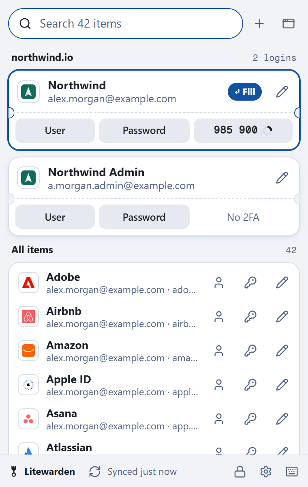
  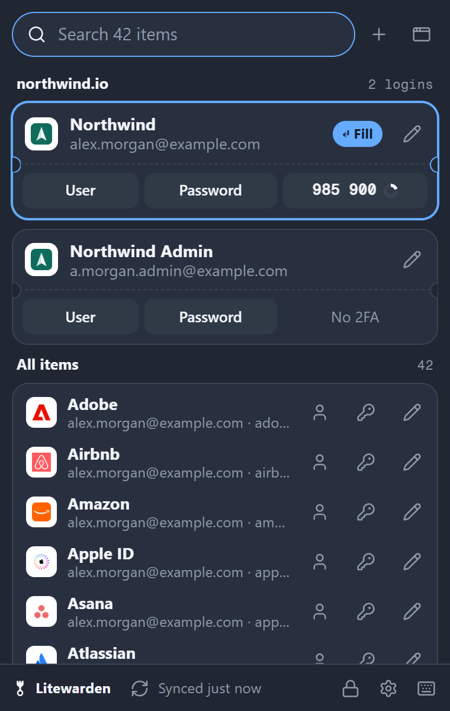
  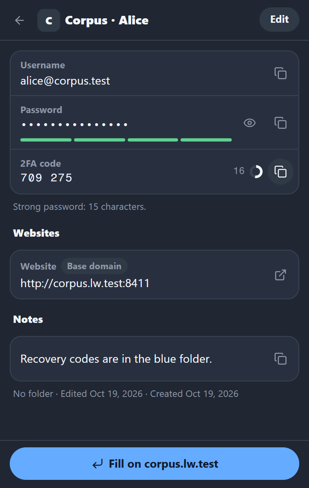
</p>
<p align="center">
  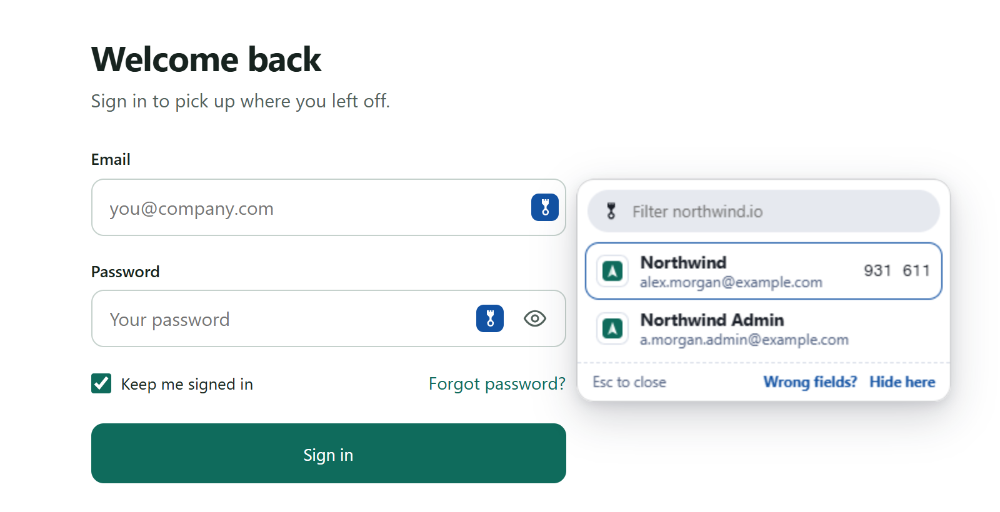
  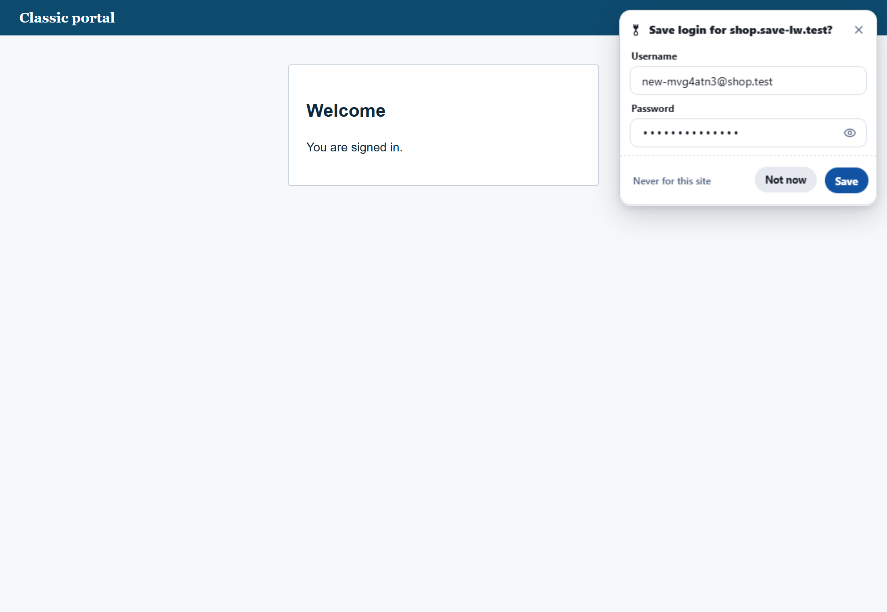
</p>
<p align="center">
  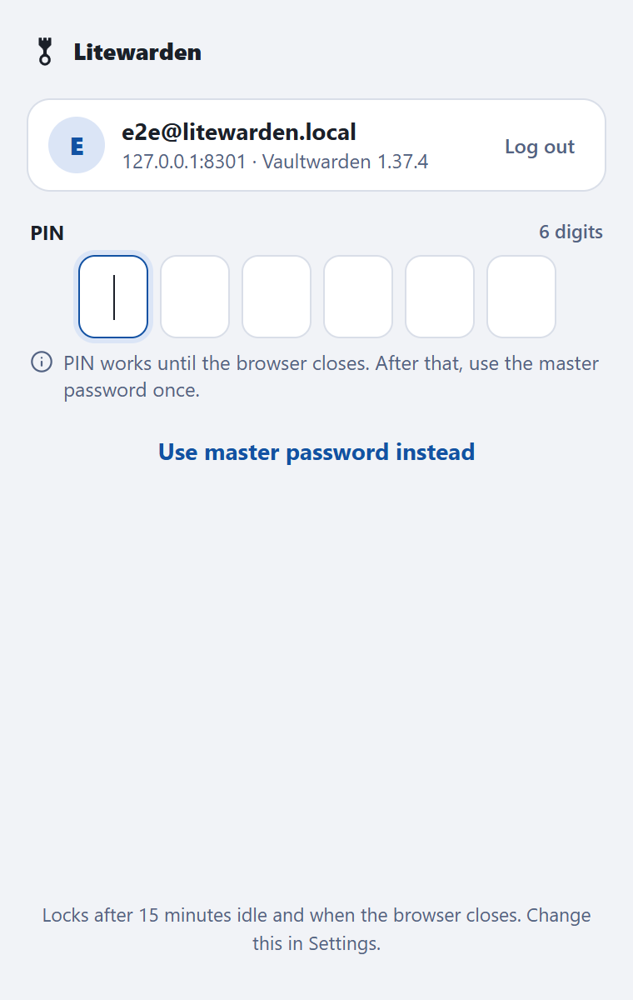
  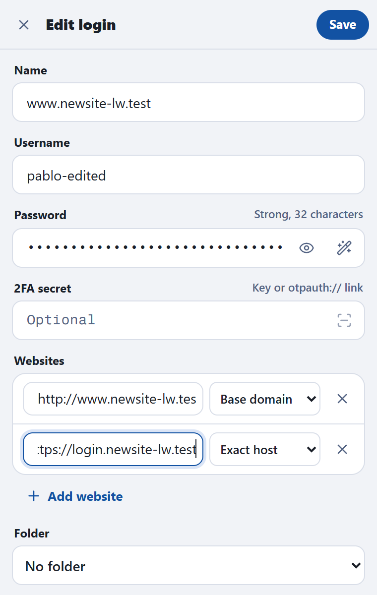
  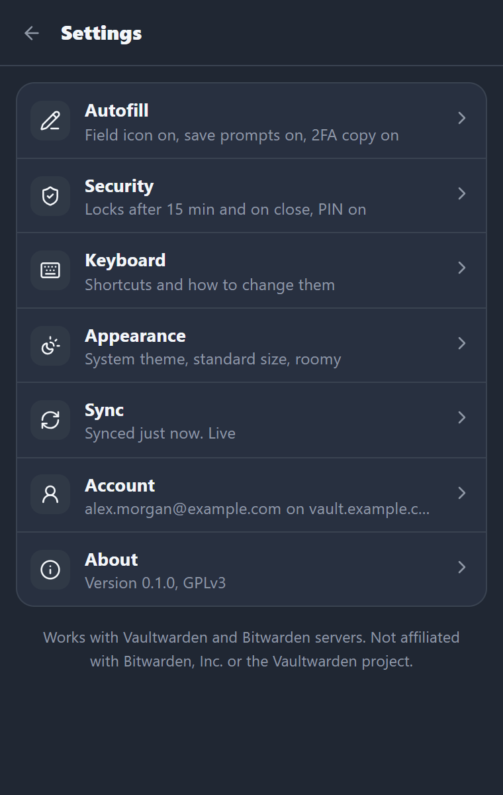
</p>

## Supported servers

| Server | Status |
|---|---|
| Vaultwarden 1.37.4, 1.37.2, 1.36.0, 1.35.8 | Tested on every change: login (PBKDF2 and Argon2id), two-step login, sync, decrypt, fill, edit, live sync |
| Other Vaultwarden 1.35 and later | Expected to work |
| Vaultwarden older than 1.35 | Litewarden tells you the server is too old |
| Bitwarden cloud (US and EU) | Supported in the code, not tested against a real account yet |

## Install

Litewarden isn't listed in the Chrome Web Store yet. Until it is, build it from source. You need Node.js 22 or
later.

```sh
git clone https://github.com/Concept211/Litewarden.git
cd litewarden
npm ci
npm run build
```

Then in Chrome (or Brave, or Edge):

1. Open `chrome://extensions` and turn on **Developer mode**.
2. Click **Load unpacked** and pick the `.output/chrome-mv3` folder.
3. Click the Litewarden icon, enter the address you use for your web vault, and sign in.

## Keyboard shortcuts

| Where | Keys | What it does |
|---|---|---|
| Anywhere in Chrome | Ctrl+Shift+L | Open Litewarden with search ready |
| In a login field | Alt+Shift+L | Open the in-page menu |
| In a login field | Right-click, Fill with Litewarden | Open the in-page menu |
| Popup | type | Search |
| Popup | ↑ ↓, Enter | Move, fill the selected login |
| Popup | Alt+← Alt+→ | Previous or next folder |
| Popup | Alt+U, Alt+P, Alt+T | Copy username, password, 2FA code |
| Popup | Alt+E | Open the item |
| Popup | Esc | Clear the search, then close |
| Popup | ? | Show all shortcuts |
| Item | Alt+R, Ctrl+S, Esc | Show or hide the password, save, back |

Change the two Chrome-wide shortcuts at `chrome://extensions/shortcuts`.

## Security and privacy

- **End-to-end encrypted**, the same way as the official clients. Your server only sees ciphertext.
- **Nothing decrypted touches the disk** by default. The unlocked key and the search index stay in the browser's
  session memory and are dropped when the browser closes.
- **Your server only.** No telemetry, no analytics, no outside services. Even site icons come from your own server.
- **No remote code.** Everything ships in the package, under a strict content security policy.
- **Clipboard** copies are cleared after 30 seconds (you can change this), unless you've copied something newer.
- **Weak server settings** get a warning. Litewarden refuses to sign in when the key derivation settings are far too
  low to be safe.

**There has been no paid security audit.** [THREAT_MODEL.md](THREAT_MODEL.md) explains what Litewarden protects,
against whom, and where the limits are. Reviews are very welcome; please send security problems through
[private reporting](https://github.com/Concept211/Litewarden/security/advisories/new). The
[privacy policy](https://concept211.github.io/Litewarden/privacy) is one page.

## FAQ

**Does it work with Bitwarden?** Yes. It talks to Bitwarden-compatible servers: self-hosted Vaultwarden, and
Bitwarden's own US and EU cloud. Vaultwarden is what it's tested against every day.

**Is it free?** Yes. GPL-3.0, no ads, no account with us, no paid tier.

**Where are my passwords stored?** On your server, encrypted. The extension keeps an encrypted copy for speed and
decrypts single items only when you open or fill them.

**Which browsers?** Chrome, Brave, Edge and other Chromium browsers. Firefox isn't supported yet.

**Passkeys, cards and identities?** Passkeys aren't supported yet. Cards, identities and custom fields show up in
the vault but can only be edited in the web vault for now.

**Can I use it next to the official extension?** Yes, but turn off autofill in one of them so you don't get two
menus in every login field.

## Development

```sh
npm ci
npm run typecheck        # TypeScript, strict
npm test                 # unit tests (crypto vectors, TOTP, URL matching, search, placement)
npm run build            # the extension, in .output/chrome-mv3
```

The live, end-to-end and soak tests run against throwaway Vaultwarden servers, never a real vault.

- **Windows:** `npm run testserver:start` starts the four versions from `_testserver/<version>/` on ports 8301 to
  8304 (Windows builds from `nextyancc/Vaultwarden-Windows-Binary`; see `scripts/testserver/`).
- **Anywhere with Docker:** run the official `vaultwarden/server` images and point the tests at them with
  `LW_SERVER_<version>` variables, for example `LW_SERVER_1_37_4=http://127.0.0.1:8301`. The CI workflow in
  `.github/workflows/ci.yml` does this.

```sh
npm run testserver:seed                         # 2,000-item test accounts
npm run test:live                               # protocol suite on every running server
E2E_VERSIONS=1.37.4 npm run e2e                 # Playwright, the built extension in Chromium
npm run soak -- --minutes 30                    # memory soak
```

The soak test writes `_testserver/soak/<run>/samples.csv` and `summary.json`: service worker, popup and page heap
after garbage collection, plus total browser memory, over time.

## Made by Concept211

Litewarden is built and maintained by [Concept211](https://concept211.com), a small software and design studio.
Other things we make:

- [Gnuke](https://getgnuke.com): get the junk out of your Gmail. One click unsubscribes from a sender and trashes
  everything they ever sent you, with Undo for 30 days.
- [ClaudeView](https://github.com/Concept211/ClaudeView): a free native Windows app for Claude Code, with chat,
  files and git in one window.
- [CarSnipe](https://carsnipe.com): instant Telegram alerts for new car listings on Facebook Marketplace.
- [ConceptSEO](https://seo.concept211.com): weekly SEO audits and AI-search readiness reports.

If Litewarden saves you time, a star on GitHub helps other Vaultwarden users find it.

## License

[GPL-3.0](LICENSE). Litewarden is an independent project. It is not affiliated with, endorsed by or sponsored by
Bitwarden, Inc. or the Vaultwarden project. "Bitwarden" is a trademark of Bitwarden, Inc.; it's used here only to
say which servers Litewarden works with.
